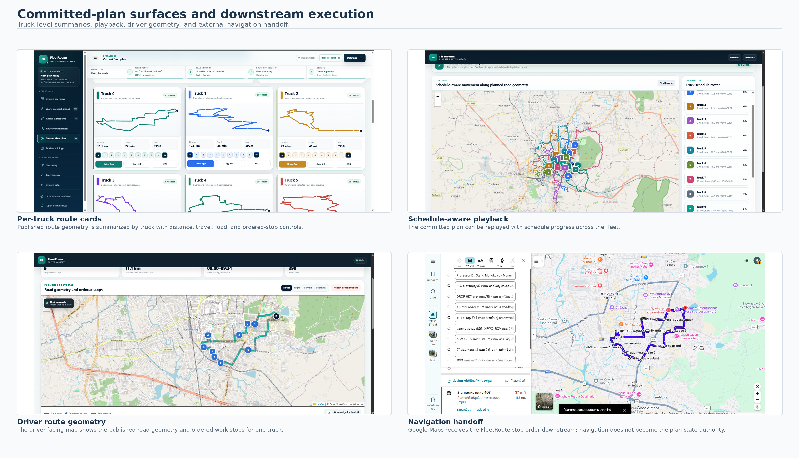
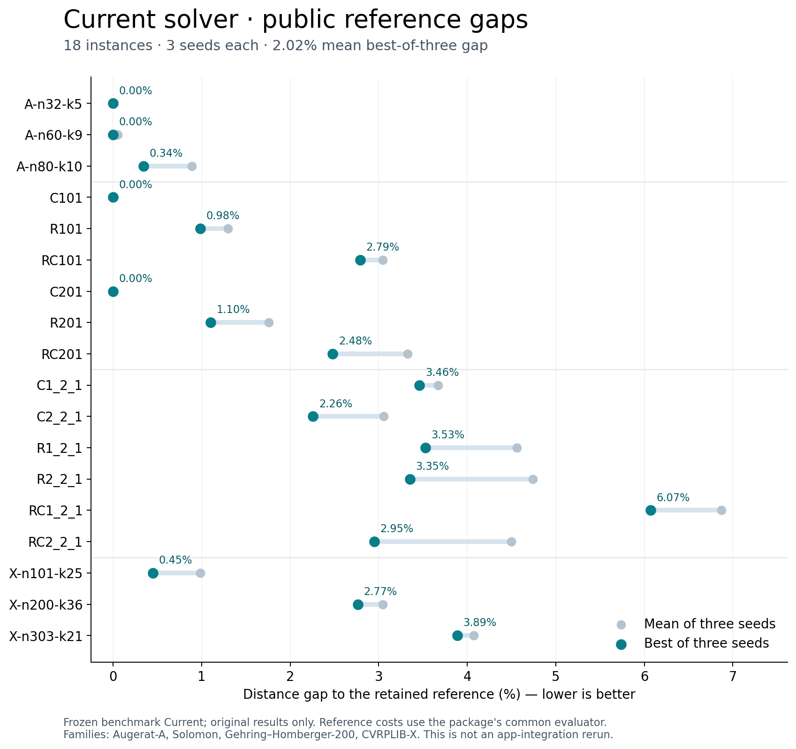

# Ratchanon Preecha · Research and Engineering

I build and test computational systems for vehicle routing, traffic control, neural-network training and signal analysis. This repository also records my work on mathematical-reasoning robustness and on how receptor measurements relate to human taste.

**Run a demo:** [FleetRoute in Colab](https://colab.research.google.com/github/preecharatchanon-arch/Ratc/blob/main/projects/fleetroute/FleetRoute_App.ipynb) · [Adaptive Signals in Colab](https://colab.research.google.com/github/preecharatchanon-arch/Ratc/blob/main/projects/adaptive-signals/AdaptiveSignals_HatYai_RealRoad_Colab.ipynb)



FleetRoute application views from a controlled planning scenario in the [submitted paper](projects/fleetroute/paper.pdf).

## Explore the questions and results

| Project | What I investigated | Open |
| --- | --- | --- |
| **FleetRoute** | How can a solver produce routes that respect road constraints and remain valid when the road graph changes? The prototype checks candidate plans before they reach the driver view. | [Application, paper and benchmark tables](projects/fleetroute/README.md) |
| **NSC 2026 waste-collection routing** | How should a fleet divide service points when proximity on a map differs from proximity on the road network? The project reached the national finals. | [Regional and finalist reports, and the presentation](projects/nsc-2026/README.md) |
| **Adaptive Signals** | Simulate vehicles, queues and signal states on Hat Yai's OpenStreetMap road network directly inside a Colab cell. | [Colab notebook and demo](projects/adaptive-signals/README.md) |
| **AIMO Interpretability** | Can measurements from the start of a model's answer predict robustness to problem variants? Vector-shape features scored 32/43, versus 33/43 for the simpler probability-summary comparator. | [Results and CPU replay](projects/aimo-interpretability/README.md#verify-the-saved-result-counts) |
| **Neural-training interventions** | Can a reproducible one-dimensional coordinate predict what changes after an optimizer-state intervention? Its frozen decoder performed worse than the zero-change baseline in both held-out query families. | [Paper, study design and submission evidence](projects/neural-training/README.md) |
| **AdamW optimizer memory** | Can a low-rank projection preserve the effect of changing first-moment memory? The short-horizon gains were descriptive, and the 64-update test underperformed zero-response prediction across eight histories. | [Manuscript and CPU verification](projects/adamw-memory/README.md) |
| **CaSR and human saltiness** | Does measured receptor activity help prioritize peptides for human saltiness? The computational and published sensory evidence has yet to establish a reliable selection rule. | [Experiments and evidence review](projects/salt-casr/README.md) |
| **Audio comparison with FFT and STFT** | What differences can be measured between two recordings? The notebook produces spectra, spectrograms and time-varying features. | [Notebook, original plots and local runner](projects/audio-fft/README.md) |

## Where the work began

I noticed irregular waste collection in Hat Yai before and after the November 2025 floods. I started asking how several trucks could serve the same neighbourhoods while respecting one-way roads, vehicle capacity and service schedules. I built a C++17 solver and a road-data workflow using OpenStreetMap. That work became my **NSC 2026 national-finalist project** and grew into FleetRoute. [Follow the original project and solver versions](projects/nsc-2026/README.md#development-across-the-competition-rounds).

## Routing benchmark evidence

The frozen solver's **mean best-of-three reference gap was 2.02% across 18 public instances**. The figure includes all 18 and shows both the best seed and the three-seed mean.



The retained CSVs support route-quality comparisons under their recorded scoring rules. The directed-road comparisons used a common evaluator and different configured budgets. [Read the comparison protocols and source identities](projects/fleetroute/README.md#read-the-results-with-their-contracts).

## Read the code or run a project

- **Routing:** [Build the C++17 solver](solvers/current/README.md#build-and-run) · [Inspect the FleetRoute application source](projects/fleetroute/source/README.md).
- **Traffic control:** [Run Adaptive Signals in Colab and watch the Hat Yai demo](projects/adaptive-signals/README.md).
- **Neural experiments:** [Review the historical training inputs](projects/neural-training/README.md#code-and-execution-scope) · [Reconstruct retained AdamW results on CPU](projects/adamw-memory/README.md#code-and-cpu-verification).
- **Audio and taste studies:** [Run the audio comparison notebook](projects/audio-fft/README.md#run-the-project) · [Open the reviewed taste-analysis notebooks](projects/salt-casr/README.md#run-an-experiment).

## Research status

FleetRoute was submitted to **IAAI-27** and was declined. The neural-training intervention study was submitted to the **AAAI-27 Student Abstract and Poster Program**. The separate AdamW low-rank study remains an unsubmitted manuscript. [FleetRoute](projects/fleetroute/README.md) · [Neural-training study](projects/neural-training/README.md) · [AdamW manuscript](projects/adamw-memory/README.md).

The taste-analysis project includes five completed computational analyses and follow-ups dated 27–29 October 2026. Its source registry distinguishes receptor activity, human saltiness and consumer liking. [Dated timeline](projects/salt-casr/docs/RESEARCH_TIMELINE.md) · [Evidence guide](projects/salt-casr/evidence-review/README.md) · [Sensory outcomes](projects/salt-casr/docs/SENSORY_OUTCOMES.md).

## Source identity and development history

The [solver index](solvers/README.md) tracks the **Legacy**, **V31**, and **Current** generations and the frozen benchmark source. [SOURCE_MANIFEST.json](SOURCE_MANIFEST.json) records archive origins and SHA-256 hashes. [ARTIFACT_CHECKSUMS.json](ARTIFACT_CHECKSUMS.json) lists repository artifact sizes and hashes, excluding the index itself.

The [targeted recovery audit](benchmarks/README.md) explains the 18 deadline-censored benchmark rows, the 17 valid recoveries and the unresolved Legacy case.

## Obtain the complete supplements

The [AAAI Student Abstract supplement](projects/neural-training/supplement.zip) is available as a single ZIP. Clone or download the repository and run the following from its root to restore the larger FleetRoute and AdamW ZIPs:

```sh
python restore_supplements.py
```

The script checks each part, the complete SHA-256, and ZIP integrity. [FleetRoute package](projects/fleetroute/supplement/README.md) · [AdamW package](projects/adamw-memory/supplement/README.md) · [CaSR run package](projects/salt-casr/archives/CaSR_Notebook_Run.zip).

## Rights

This code remains proprietary. Reviewers may download it and run the documented commands for academic evaluation. Other copying, modification, redistribution or commercial use requires the author's permission.

Third-party datasets and map data retain their own rights and attribution requirements; see the [data notice](projects/fleetroute/THIRD_PARTY_DATA_NOTICE.md). Hosting an artifact here does not grant a new license to its code or data.
