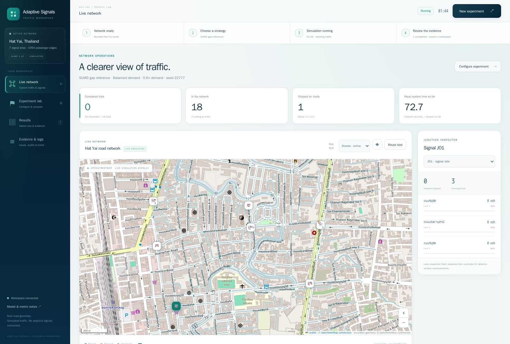

# Adaptive Signals · Hat Yai traffic workspace

**[Open the blue Hat Yai notebook in Google Colab](https://colab.research.google.com/github/preecharatchanon-arch/Ratc/blob/main/projects/adaptive-signals/AdaptiveSignals_HatYai_Blue_Colab.ipynb)** · [View the notebook](AdaptiveSignals_HatYai_Blue_Colab.ipynb)

This version restores the last archived blue workspace from `reference/frontend_previous` in the Junction release. The notebook keeps the SUMO 1.25.0 engine and the bundled Hat Yai OpenStreetMap road model. The model has 1,054 directed road edges and seven signal-controller groups. All 40 bundled Python tests passed after the blue frontend was restored.

Run the first two cells on a Colab CPU runtime. In **Live network**, choose **Run quick demo**, then set **Map style** to **Streets · online** to show the OpenStreetMap basemap. **Analysis · local** draws the same road geometry when network tiles are unavailable. Vehicle demand is simulated, and the intersection configuration is for research use.

## Live Colab demo

[Watch the 12-second Colab recording](hatyai-blue-colab-live.mp4) · [View the run details](hatyai-blue-colab-run.json)

The recording shows the **Streets · online** basemap, simulated vehicles and signal states from a Google Colab CPU run. The simulation clock advances from 00:12 to 03:42 in the Hat Yai quick demo (SUMO gap-actuated reference controller, seed 22777).

Map data © OpenStreetMap contributors, ODbL 1.0.

## Archived Stage 2 prototype

**Archived prototype · October 2026**

I built this Stage 2 prototype to test how signal controllers respond when demand changes across neighbouring intersections. The original dark-blue Colab viewer shows vehicles, signal phases and approach queues from a running SUMO simulation on a synthetic nine-intersection grid.

**[Open the original notebook in Google Colab](https://colab.research.google.com/github/preecharatchanon-arch/Ratc/blob/main/projects/adaptive-signals/AdaptiveSignals_Stage2_Live_Colab.ipynb)** · [View the notebook on GitHub](AdaptiveSignals_Stage2_Live_Colab.ipynb)

## Run the viewer

1. Open the notebook in a Colab CPU runtime and run the first two code cells in order.
2. In the second cell's output, click **Start / reset run**. Keep the runtime connected while using the viewer.
3. Use the same demand pattern, load, and seed to compare controllers. The viewer also supports pausing, stepping one second at a time, and adjusting simulated detector errors.

The notebook bundles the C++17 controllers, Python runner, viewer and tests. The first cell installs SUMO 1.25.0 and compiles the controllers with `g++`. The optional third cell displays the saved summary and can rerun or export the benchmark.

## Experiment scope

The archived campaign contains 48 development runs and 284 evaluation runs. It compares fixed timing, native SUMO actuation and adaptive C++ heuristics using mean system time per requested vehicle within a fixed simulation horizon. The metric counts unfinished trips and requests still waiting to enter.

For example, on the archived balanced-demand case at ×0.6 load, the saved means were **442.1 s/request** for tuned fixed timing, **361.7** for native actuation and **241.7** for the C++ discharge controller. These values describe a synthetic scenario and its recorded seeds. The notebook contains the other cases and the checks for trip accounting and signal clearance.
