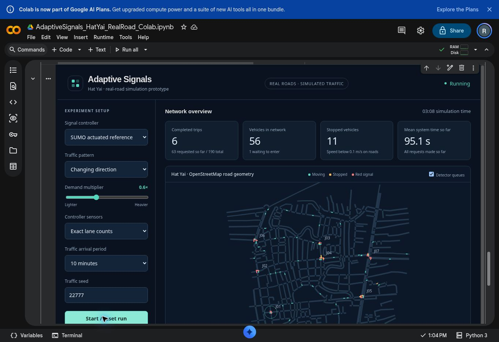

# Adaptive Signals · Hat Yai

Adaptive Signals is a SUMO traffic simulator for seven signal groups in Hat Yai, Thailand. The model uses 1,054 directed road segments from OpenStreetMap. Inside Colab, the viewer shows where simulated vehicles move or queue as traffic shifts between directions.

**[Open in Google Colab](https://colab.research.google.com/github/preecharatchanon-arch/Ratc/blob/main/projects/adaptive-signals/AdaptiveSignals_HatYai_RealRoad_Colab.ipynb)** · **[Watch the 20-second recording](hat-yai-colab.mp4)** · [Recording details](hat-yai-colab-recording.json)

## Run the simulation

1. Open the notebook with a CPU runtime and run the first two code cells.
2. In the second cell's output, choose a controller and traffic pattern, then select **Start / reset run**. The screenshot uses SUMO's actuated reference controller and the **Changing direction** scenario.
3. Select a junction to inspect its queues. Use the counters and the queue chart to see how many trips finish and where vehicles accumulate. To compare controllers, keep the traffic pattern, demand multiplier, arrival period and seed fixed.

The street geometry comes from OpenStreetMap and vehicle arrivals are simulated. The lane, turn and signal configurations require field validation before the model can inform traffic operations.

Map data © [OpenStreetMap contributors](https://www.openstreetmap.org/copyright), ODbL 1.0.
