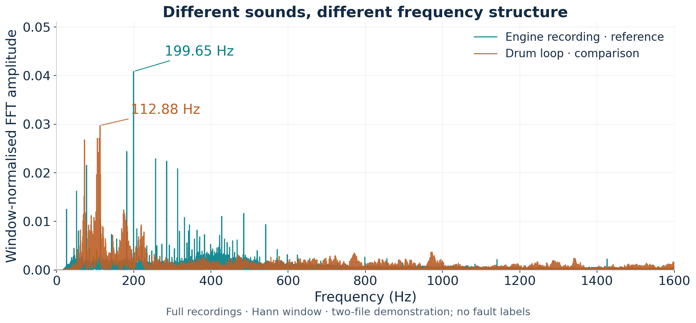
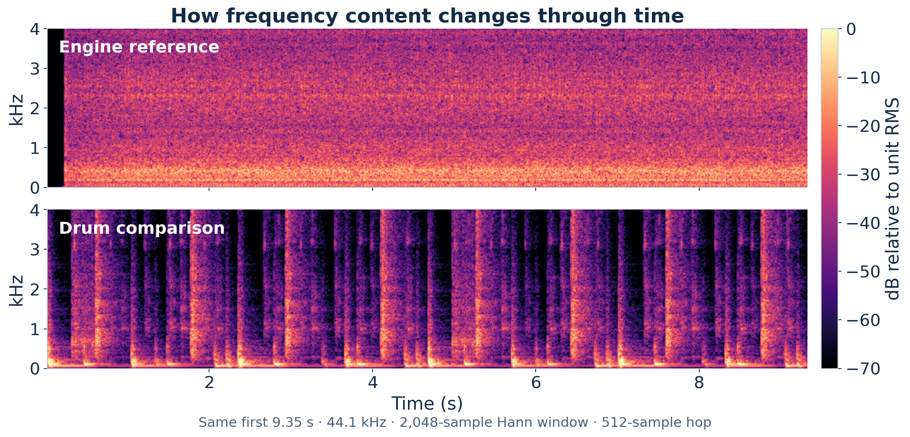
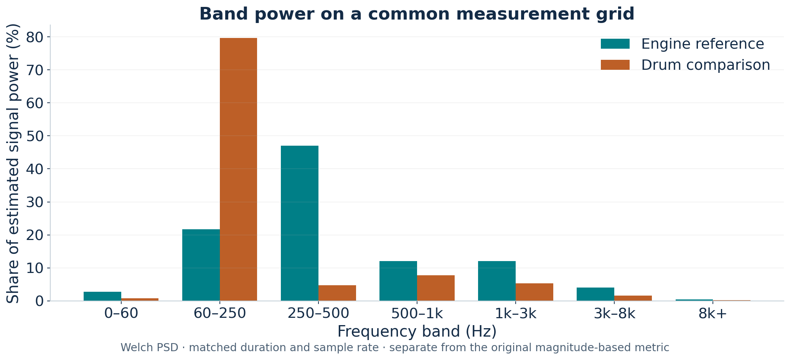

# Two-File Audio Fault Analyzer

An exploratory Python signal-processing project: decode two audio recordings, inspect their FFT spectra and time-varying features, and compare a reference recording with a test recording. The intended application was investigating changes in engine sound. The retained demonstration compares a diesel-engine recording with a drum loop; it establishes the analysis workflow, not engine-fault detection accuracy.

**Project origin:** 23 March 2026, as reported by the author. **Evidence rerun:** 10 October 2026, using the code and two MP3 files supplied by the author. The dated origin is a recollection, not a recovered March notebook timestamp.

**Open:** [Colab notebook](audio_fft_analysis.ipynb) · [Analysis functions](original_prototype.py) · [Reproduction runner](run_analysis.py) · [Results JSON](results/results.json) · [Feature table](results/global_features.csv) · [Audit](AUDIT.md)

## From audio to measurable features

MP3/WAV decoding produces PCM samples, with stereo channels averaged to mono. The prototype applies a 20 Hz high-pass filter, removes the mean and uses a Hann window before a real-valued FFT. It calculates spectral peaks, centroid, flatness, entropy, rolloff, RMS and crest factor. A 30 ms frame with a 10 ms hop tracks spectral flux, harmonic matching and within-recording outliers using a median absolute deviation (MAD) score. STFT spectrograms make the changing frequency content visible.

The project combines **NumPy, SciPy, pydub, FFmpeg and Matplotlib**. It is a personal project, not a competition submission or published study.

## Evidence from the supplied recordings



Full-recording spectra with Hann-window amplitude normalisation. The engine recording's strongest FFT bin is **199.65 Hz**; the drum loop's is **112.88 Hz**. These are dominant spectral bins, not established shaft speeds or fault frequencies.



The comparison uses the same first **9.35 seconds**, a common **44.1 kHz** sample rate, a 2,048-sample Hann window and a 512-sample hop. Each signal is normalised to unit RMS for this display, and both panels share the colour scale. The drum loop has repeated broadband transients; the engine clip has more sustained low-frequency structure. This is an observation about these recordings.

| Original prototype feature | Engine recording | Drum loop |
| --- | ---: | ---: |
| Duration | 31.54 s | 9.35 s |
| Native sample rate | 48,000 Hz | 44,100 Hz |
| Dominant FFT bin | 199.65 Hz | 112.88 Hz |
| Magnitude-weighted centroid | 3,174.69 Hz | 2,494.54 Hz |
| RMS after the original filtering | 0.109770 | 0.111534 |
| Within-recording flagged-frame fraction | 0.0301 | 0.4062 |

The supplied log has **drums as baseline and engine as test**, because it chose the first uploaded file. The rerun preserves that ordering for reproduction and also records the author's intended **engine reference → drum comparison** ordering. The original severity is 0.471 in the former order and 0.456 in the latter. These are hand-weighted feature differences, not probabilities of engine failure.



This additional October analysis uses Welch power spectral density on matched duration and a shared frequency grid. It is explicitly separate from the original `band_energy` function, which sums FFT magnitudes rather than power. The original calculations remain available in the reproduction files.

## Run the project

Open [the notebook in Google Colab](https://colab.research.google.com/github/preecharatchanon-arch/Ratc/blob/main/projects/audio-fft/audio_fft_analysis.ipynb), run setup, upload the recordings, and set their roles by filename. It embeds the analysis code and does not rely on upload order.

For local use, install FFmpeg through your operating system's package manager, then:

```sh
python -m pip install -r requirements.txt
python run_analysis.py --engine /path/to/engine.mp3 --comparison /path/to/drum.mp3
python check_evidence.py
```

The runner exports three figures, global and frame-level CSVs, input SHA-256 hashes, the environment and both ordering results. It contains no trained classifier. The Colab entry point is an October restoration of the supplied prototype, with explicit file roles and evidence export; it is not claimed to be the original March notebook.

## Scope and next step

The prototype successfully produces frequency-domain and time-frequency evidence from real recordings. It has **not** been validated on matched healthy/faulty engine recordings. RPM, load, microphone placement and recording conditions would need to be controlled or measured before a sound difference could support a specific mechanical diagnosis. The stock engine recording itself carries no verified healthy-engine label.

The original heuristic labels both demonstration files as percussive. Its entropy, clipping and transient-decay calculations also need careful interpretation; see [the technical audit](AUDIT.md). The portfolio therefore presents a completed exploratory signal-analysis project, with the evidence needed to inspect what it actually measures.

## Audio sources and rights

- [Diesel Car Engine Sound — manshaofficial, Pixabay](https://pixabay.com/sound-effects/city-diesel-car-engine-sound-111994/)
- [Timbo Drumline Loop 103bpm — kamhunt, Pixabay](https://pixabay.com/sound-effects/timbo-drumline-loop-103bpm-171091/)

The original MP3 files are not redistributed in this repository. Download them from their source pages, subject to the [Pixabay Content License](https://pixabay.com/service/license-summary/). The exact files used here are identified by the hashes in [results.json](results/results.json). Graphs and numeric features were generated from the supplied copies. The repository's existing code-rights notice applies; this project does not change it.
