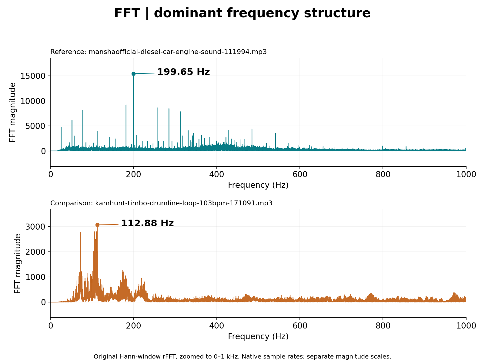
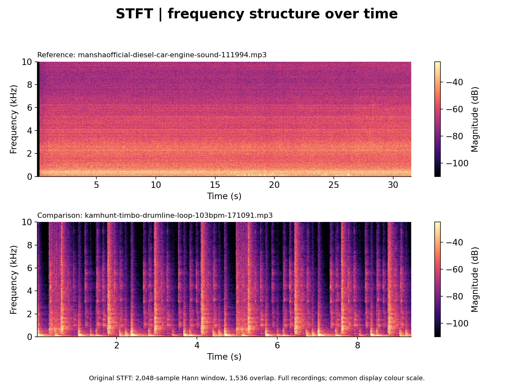

# Two-File Audio Fault Analyzer

An exploratory Python signal-processing project: decode two audio recordings, inspect their FFT spectra and time-varying features, and compare a reference recording with a test recording. The intended application was investigating changes in engine sound. The retained demonstration compares a diesel-engine recording with a drum loop; it establishes the analysis workflow, not engine-fault detection accuracy.

**Project origin:** 23 March 2026, as reported by the author. **Evidence rerun:** 10 October 2026, using the code and two MP3 files supplied by the author. The dated origin is a recollection, not a recovered March notebook timestamp.

**Open:** [Colab notebook](audio_fft_analysis.ipynb) · [Analysis functions](original_prototype.py) · [Reproduction runner](run_analysis.py) · [Results JSON](results/results.json) · [Feature table](results/global_features.csv) · [Audit](AUDIT.md)

## From audio to measurable features

MP3/WAV decoding produces PCM samples, with stereo channels averaged to mono. The prototype applies a 20 Hz high-pass filter, removes the mean and uses a Hann window before a real-valued FFT. It calculates spectral peaks, centroid, flatness, entropy, rolloff, RMS and crest factor. A 30 ms frame with a 10 ms hop tracks spectral flux, harmonic matching and within-recording outliers using a median absolute deviation (MAD) score. STFT spectrograms make the changing frequency content visible.

The project combines **NumPy, SciPy, pydub, FFmpeg and Matplotlib**. It is a personal project, not a competition submission or published study.

## Evidence from the supplied recordings



The original Hann-window real FFT, shown at each recording's native sample rate. The view zooms to **0–1 kHz**; the two magnitude scales are independent. The engine recording's strongest bin is **199.65 Hz**, and the drum loop's is **112.88 Hz**. These are measured spectral bins, not established shaft speeds or fault frequencies.



The original STFT uses a **2,048-sample Hann window** with **1,536 samples of overlap**. Each full recording retains its native sample rate and duration. The panels share only a display colour scale; no resampling, RMS normalisation or Welch analysis is added. The engine clip shows sustained low-frequency content, while the drum loop shows repeated broadband transients.

[All 15 original output plots and the complete text report](original-run/README.md) are retained from the engine-reference / drum-comparison run. These are the outputs of `run_analysis.py`. [The paired-figure script](make_portfolio_figures.py) only redraws the same FFT/STFT calculations in a compact layout for the portfolio; it does not change the notebook or add a new analysis method.

| Original prototype feature | Engine recording | Drum loop |
| --- | ---: | ---: |
| Duration | 31.54 s | 9.35 s |
| Native sample rate | 48,000 Hz | 44,100 Hz |
| Dominant FFT bin | 199.65 Hz | 112.88 Hz |
| Magnitude-weighted centroid | 3,174.69 Hz | 2,494.54 Hz |
| RMS after the original filtering | 0.109770 | 0.111534 |
| Within-recording flagged-frame fraction | 0.0301 | 0.4062 |

The supplied log has **drums as baseline and engine as test**, because it chose the first uploaded file. The rerun preserves that ordering for reproduction and also records the author's intended **engine reference → drum comparison** ordering. The original severity is 0.471 in the former order and 0.456 in the latter. These are hand-weighted feature differences, not probabilities of engine failure.

## Run the project

Open [the notebook in Google Colab](https://colab.research.google.com/github/preecharatchanon-arch/Ratc/blob/main/projects/audio-fft/audio_fft_analysis.ipynb) and run its **single code cell**:

1. Upload your audio recordings.
2. Select the reference/baseline file number, then the test/comparison file number.
3. Read the printed summaries and view all **15 original graphs**.

The cell installs its dependencies and includes the analysis code directly. It accepts your own filenames and does not require the example engine or drum recordings. It saves `analysis.txt` and all 15 PNGs to **`/content/audio_fft_results/`**, visible in Colab's Files panel. Rerunning replaces the outputs in that folder; download them first if you want to keep a previous run.

The original plots are restored: waveform, FFT spectrum, labelled main peaks and STFT spectrogram for each file (eight plots), plus RMS, centroid, flatness, spectral flux, harmonic score, anomaly score and onset-detector comparisons (seven plots).

For local use, install FFmpeg, then:

```sh
python -m pip install -r requirements.txt
python run_analysis.py --reference "/path/to/reference.wav" --comparison "/path/to/test.mp3" --output "/path/to/my-results"
```

The local runner writes the same text report and plots. The notebook keeps the original calculation definitions, plot settings and heuristic scores; the changes are explicit file selection and saving the displayed outputs.

The [earlier normalised FFT](figures/fft_comparison.png), [matched-support STFT](figures/stft_comparison.png), [additional Welch band-power plot](figures/band_power_comparison.png) and files in `results/` remain archived October audit evidence. They are not the original notebook output shown above. They are separate from the notebook's full output. The additional matched-support Welch plot is not part of the original notebook. Its [earlier evidence-generation runner](https://github.com/preecharatchanon-arch/Ratc/blob/bb944236d7b11d8de67b7e7f1f59dfd51121b197/projects/audio-fft/run_analysis.py) remains in the repository history. `python check_evidence.py` checks the archived numbers and measurement sanity.

## Scope and next step

The prototype successfully produces frequency-domain and time-frequency evidence from real recordings. It has **not** been validated on matched healthy/faulty engine recordings. RPM, load, microphone placement and recording conditions would need to be controlled or measured before a sound difference could support a specific mechanical diagnosis. The stock engine recording itself carries no verified healthy-engine label.

The original heuristic labels both demonstration files as percussive. Its entropy, clipping and transient-decay calculations also need careful interpretation; see [the technical audit](AUDIT.md). The portfolio therefore presents a completed exploratory signal-analysis project, with the evidence needed to inspect what it actually measures.

## Audio sources and rights

- [Diesel Car Engine Sound — manshaofficial, Pixabay](https://pixabay.com/sound-effects/city-diesel-car-engine-sound-111994/)
- [Timbo Drumline Loop 103bpm — kamhunt, Pixabay](https://pixabay.com/sound-effects/timbo-drumline-loop-103bpm-171091/)

The original MP3 files are not redistributed in this repository. Download them from their source pages, subject to the [Pixabay Content License](https://pixabay.com/service/license-summary/). The exact files used here are identified by the hashes in [results.json](results/results.json). Graphs and numeric features were generated from the supplied copies. The repository's existing code-rights notice applies; this project does not change it.
