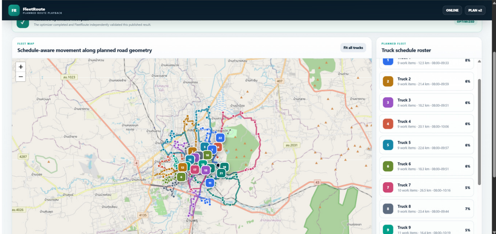
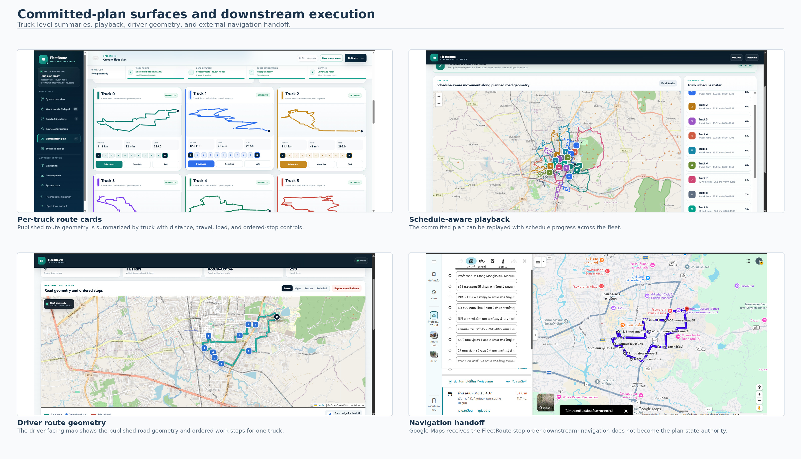
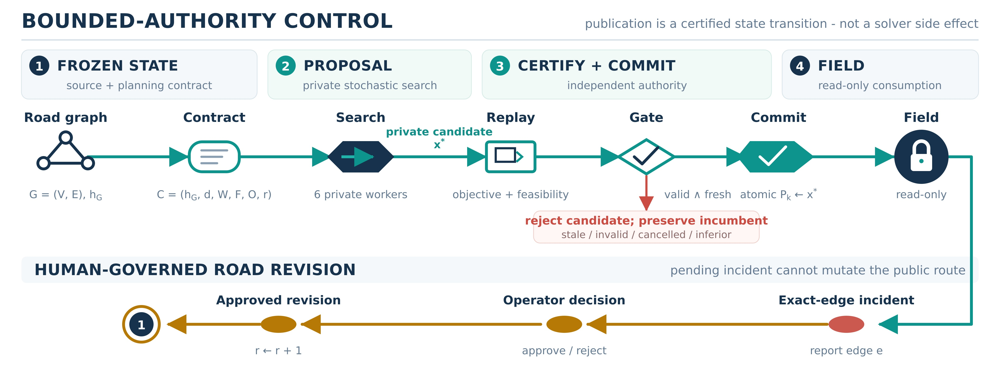
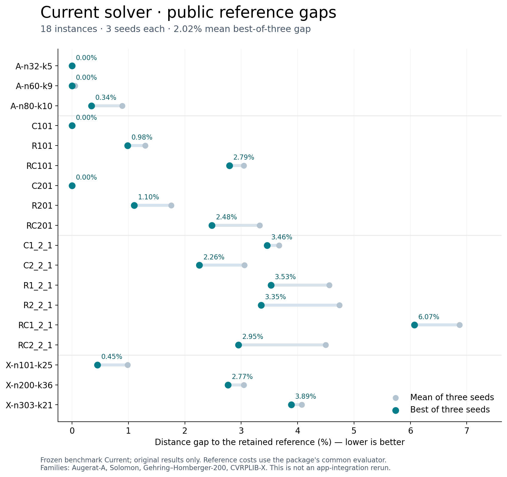
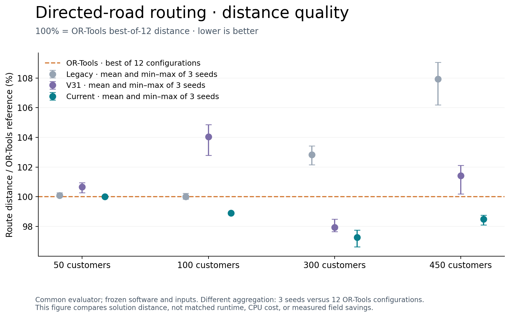

# FleetRoute: Bounded-Authority Route Optimization for Auditable Real-Road Fleet Operations

**Author:** Ratchanon Preecha  
**Status:** Submitted to the Innovative Applications of Artificial Intelligence Conference (IAAI-27); acceptance is not claimed.

FleetRoute develops a routing algorithm into an inspectable application. Real road networks are represented as directed graphs, and candidate routes pass explicit validation before the system reports a result. Bounded execution, progress telemetry, and structured receipts make the optimization process auditable.

## Project and source

- [Read the paper (PDF)](paper.pdf)
- [Complete submission supplement and restoration instructions](supplement/README.md)
- [Application notebook](FleetRoute_App.ipynb)
- [Current solver](../../solvers/current/README.md)
- [Versioned solver sources](../../solvers/README.md)
- [Submission evidence](evidence/submission.png)
- [Third-party data notice](THIRD_PARTY_DATA_NOTICE.md)

The work extends the NSC 2026 finalist project **ระบบเพิ่มประสิทธิภาพเส้นทางรถเก็บขยะหลายคัน บนโครงข่ายถนนจริงด้วยอัลกอริทึมไฮบริดเมตาฮิวริสติก**. Its [NSC reports and finalist presentation](../nsc-2026/README.md) document Legacy at the regional stage and V31 at the finalist stage. Planner and driver workflows already existed in the finalist application. The subsequent IAAI work expands the Thailand-only PBF workflow to international region selection and strengthens road-data handling, spatial indexing, backend execution, validation, lifecycle management and inspectable evidence around the optimization core.

## Application and control architecture

A single application panel from Figure 5 in the submitted paper, showing the committed fleet plan and schedule-aware playback. This is a controlled prototype scenario.

Per-truck route cards, schedule-aware playback, driver route geometry, and navigation handoff from the controlled scenario in the submitted paper (Figure 5). These are application surfaces, rather than evidence of a field deployment.

Figure 1 from the submitted paper. The solver proposes a private candidate; independent replay and the commit gate determine whether it becomes the public plan. Road incidents stay pending until operator action creates an approved revision.

## Read the results with their contracts

| Evidence | Interpretation |
| --- | --- |
| [Public reference gaps](tables/current_public_reference_gaps.csv) | Frozen Current results against public reference solutions |
| [Original paired comparisons](tables/paired_comparison_strict_parent_original.csv) | Complete triples from the original parent experiment |
| [Recovery-augmented comparisons](tables/paired_comparison_recovery_augmented_descriptive.csv) | Descriptive comparisons after targeted recovery |
| [Directed-road comparison](tables/osm_four_way_common_metric.csv) | Four-way comparison under the common metric |
| [Claim receipt](tables/PAPER_CLAIMS_RECEIPT.json) | Machine-readable scope and claim provenance |

The frozen package reports a mean best-of-three reference gap of **2.02% over 18 public instances**. In the directed-road comparisons, Current's mean common-evaluator route distance was 0%, 1.10%, 2.73%, and 1.51% lower than OR-Tools for the 50-, 100-, 300-, and 450-customer cases respectively. These are solution-quality comparisons under the retained protocol, not matched end-to-end runtime comparisons.

The parent batch used six software workers on two runtime-visible logical CPUs. The original and recovery-augmented results must remain distinct: 180 parent-valid runs became 197 valid outcomes after 17 successful targeted recoveries. One Legacy case remained unresolved.

## Reproduction scope

The complete submission supplement includes the frozen inputs, retained source snapshots, raw results, an independent common-objective evaluator, table reconstruction tools, and the application notebook. The application is a predeployment research system; the package does not establish measured field savings.

## Benchmark figures

Best and mean distances use three seeds for each instance. All Current rows shown are original parent results. Reference costs and scoring conventions are those retained in the package; the figure does not certify a new best-known solution.

Dots show the three-seed mean; whiskers show the observed minimum and maximum, not confidence intervals. The OR-Tools baseline is the best of twelve configurations. The comparison covers solution distance under a common evaluator, with different aggregation and configured budgets.

Rebuild both figures with `python make_figures.py` from this directory (requires NumPy and Matplotlib). The [script](make_figures.py) reads the public CSVs and performs no solver runs. SVG copies are included for export.
