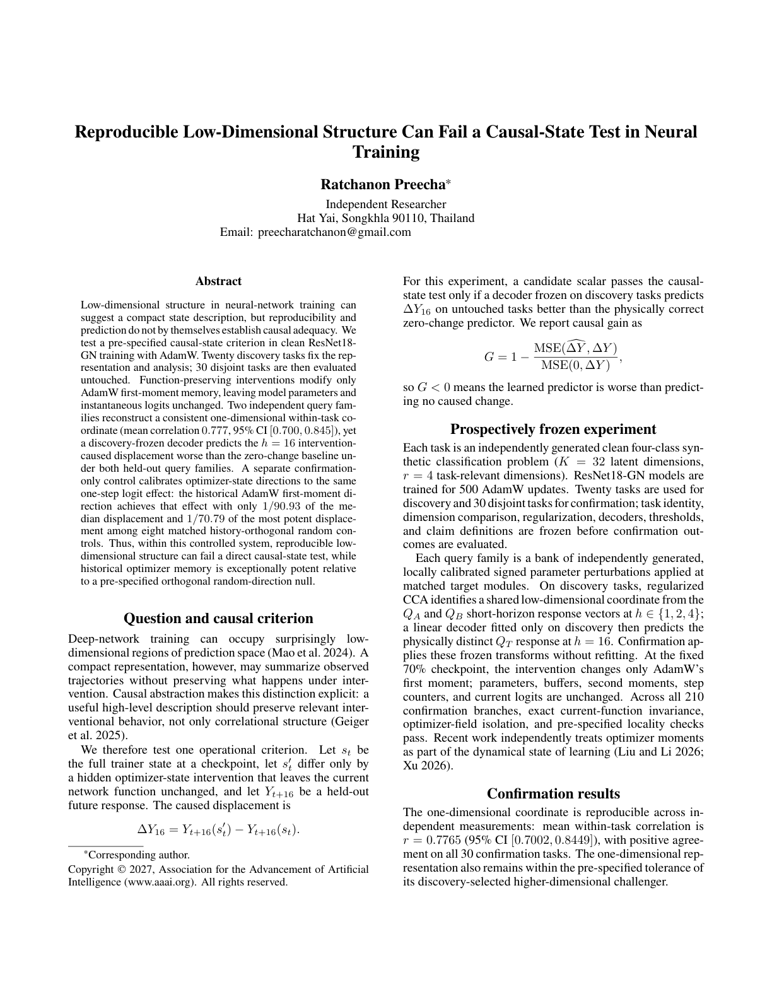
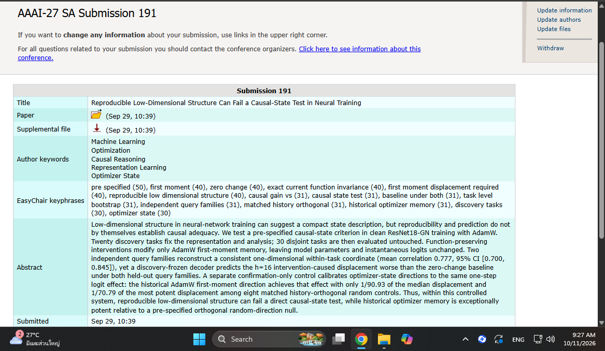

# Reproducible Low-Dimensional Structure Can Fail a Causal-State Test in Neural Training

**Author:** Ratchanon Preecha  
**Status:** Submitted to the AAAI-27 Student Abstract and Poster Program, submission 191; acceptance is not claimed.

The study asks whether a compact representation of neural training preserves the effects of intervention, rather than merely reproducing a pattern in observations.

## Experiment

ResNet18-GN models are trained with AdamW on clean synthetic classification tasks. Twenty discovery tasks fix the representation and analysis; thirty disjoint confirmation tasks are evaluated without refitting. Function-preserving interventions change only AdamW's first-moment memory while holding model parameters and instantaneous logits unchanged.

A discovery-frozen decoder must predict the intervention-caused displacement at a sixteen-update horizon better than predicting zero displacement. Two independent query families provide separate measurements of the candidate coordinate.

## Main finding

The one-dimensional coordinate is reproducible: mean within-task correlation is **0.7765**, with a 95% confidence interval of **[0.7002, 0.8449]**. However, the frozen decoder performs worse than the zero-change baseline under both held-out query families.

In a separate confirmation-only control, the historical first-moment direction reaches the calibrated one-step logit effect with **1/90.93** of the median displacement required by eight history-orthogonal random controls. That result establishes potency relative to the specified control directions; it does not certify the scalar representation as causally sufficient.

The contribution is a direct test separating reproducibility, prediction, and causal adequacy within a controlled training system.

## Evidence

This is a rendering of the supplied paper's first page. The submission records below document submission 191 to the AAAI-27 Student Abstract and Poster Program; they do not establish acceptance.

- [Read the paper (PDF)](paper.pdf)
- [Download the final supplementary package](supplement.zip)
- [Original submission record](evidence/submission_4.png)
- [Current submission details](evidence/submission_5.png)

The author supplied this updated EasyChair screenshot on 11 October 2026. Its abstract matches the paper; the paper and supplement retain their 29 September upload timestamps. The screenshot documents submission 191. Acceptance is not claimed.

The supplementary package contains the final twenty-task discovery / thirty-task confirmation evidence and independent checks. Earlier exploratory runs are history, not extra confirmation tasks.

The public paper copy omits the author's phone number. Its scientific text and results match the supplied submission.

## Code and execution scope

The [exposed supplementary files](source/README.txt) are unchanged copies of all ten files in the submitted ZIP. Review the [final confirmation-completion notebook](source/evidence/02_final_confirmation_notebook.ipynb), [final claims JSON](source/evidence/01_final_confirmation_claims.json), [prospective protocol audit](source/evidence/03_parent_pre_data_audit.md) and [run receipt](source/evidence/07_final_run_receipt_excerpt.txt) directly on GitHub.

The notebook completes three missing confirmation tasks while preserving 27 sealed parent tasks. It requires the original parent Stage-6 results ZIP, its recorded identity, Google Colab/Drive and the experiment's training dependencies. That parent archive is not included in this concise submission supplement, so this notebook is **not a standalone fresh-training example**. Opening it exposes the exact code; the supplied claims and receipt can be inspected without launching training.

The final scientific result covers the complete 30-task confirmation cohort. A code listing or receipt alone does not reconstruct all historical response arrays. The [supplement PDF](source/00_Supplement.pdf) explains the protocol and findings.
