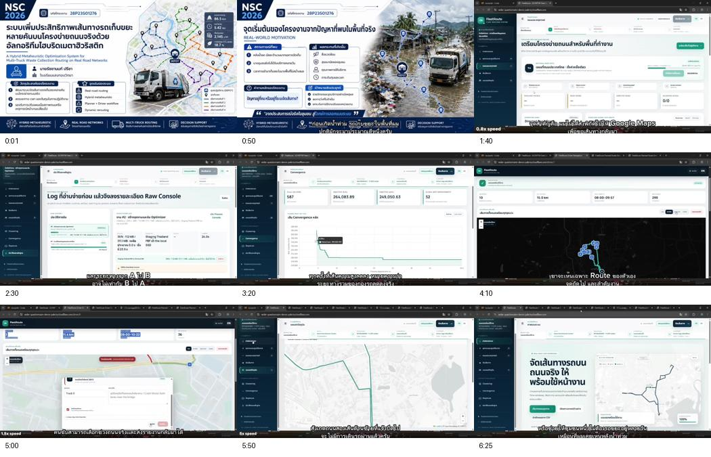

# A Hybrid Metaheuristic Optimization System for Multi-Truck Waste Collection Routing on Real Road Networks

**Original Thai title:** ระบบเพิ่มประสิทธิภาพเส้นทางรถเก็บขยะหลายคัน บนโครงข่ายถนนจริงด้วยอัลกอริทึมไฮบริดเมตาฮิวริสติก  
**Developer:** Ratchanon Preecha  
**Project code:** 28P23S01276  
**Competition:** The 28th National Software Contest (NSC 2026), student level, category 23: application software. National finalist, as reported by the author and recorded in the finalist report.

The project develops multi-truck waste-collection routing on a directed real-road network, under capacity and service-time constraints. The original road-data workflow downloads a Thailand OpenStreetMap PBF extract and builds the operational graph. The later international FleetRoute work has its own [research page](../fleetroute/README.md).

## Read the evidence

- [Finalist report — 100 pages, August 2026](reports/finalist-report.pdf)
- [Regional report — 158 pages, July 2026](reports/regional-report.pdf)
- [Finalist presentation — full 6-minute-30-second video](evidence/finalist-presentation.mp4)
- [Evidence provenance and checksums](EVIDENCE_MANIFEST.json)

The presentation is a smaller H.264/AAC copy of the supplied video, with the sequence and audio retained. It can be downloaded from the file page if GitHub does not play it inline. The two public report copies omit the author's phone number; their remaining text and technical results are unchanged.

Frames at 0:01, 0:50, 1:40, 2:30, 3:20, 4:10, 5:00, 5:50, and 6:25 show the project introduction, motivation, Thailand road preparation, logs, convergence, driver views, and road-incident workflow. These document a prototype demonstration.

## Development across the competition rounds

| Stage | Solver generation | Engineering focus | Evidence |
| --- | --- | --- | --- |
| Regional round | Legacy | Directed-road formulation, hybrid search and independently checked route results | July report, 158 pages |
| Finalist round | V31 | Early high-throughput destroy-and-repair LNS, followed by deeper local-search intensification; planner and driver workflows on the Thailand road-data pipeline | August report, 100 pages, and presentation video |
| Subsequent IAAI-27 work | Current / FleetRoute integration | International region selection, stronger data and execution contracts, spatial indexing, backend refinements, validation, and auditable application workflows | [FleetRoute paper, application and supplement](../fleetroute/README.md) |

The author supplied this round-to-generation mapping on 10 October 2026. The reports use historical terms such as “current backend”; in the finalist report that describes the V31 stage, not the later benchmark snapshot called Current in the IAAI package. [Retained solver sources](../../solvers/README.md) are identified by their exact archive origin and hash. Generation labels do not establish that an archived snapshot is byte-identical to the executable used on the competition stage.

## What changed at the finalist stage

The August report separates an early ThroughputLNS phase from deep search (PDF pages 21–23). Low-cost destroy-and-repair operations seek improvements while preserving a feasible incumbent and collecting elite candidates. Deeper search then combines parallel simulated annealing, multi-level reconstruction, granular tabu intensification, elite reuse, path relinking, and final refinement.

The presentation already includes planner and driver views, convergence, logs, and a road-incident workflow. Subsequent FleetRoute development expands and strengthens this operating system around the solver; the chronology does not treat every interface or validation feature as newly introduced after NSC.

## Keep each experiment's protocol

The finalist report's common-metric comparison (PDF pages 59–61) records a tie at 50 customers, a loss at 100, and shorter mean routes at 300 and 450, with reported margins of 3.507% and 1.970%. Its independent CP-SAT checks cover 10-, 15-, and 20-customer cases with a reported 0.3933% gap (PDF pages 62–63).

Those are historical NSC results under the report's retained protocol. The [later IAAI tables and graphs](../fleetroute/README.md#benchmark-figures) use their own frozen inputs, source snapshots, evaluator and aggregation. They are separate experiments. The reports and video do not establish measured municipal deployment savings or isolate an operator's causal contribution to performance.

The reports and presentation provide the technical project evidence. Award certificates remain separate competition evidence.
