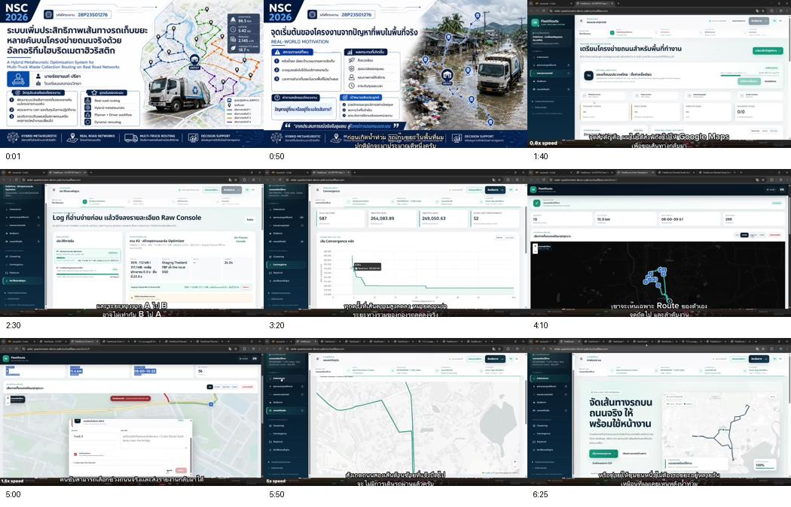

# A Hybrid Metaheuristic Optimization System for Multi-Truck Waste Collection Routing on Real Road Networks

**Original Thai title:** ระบบเพิ่มประสิทธิภาพเส้นทางรถเก็บขยะหลายคัน บนโครงข่ายถนนจริงด้วยอัลกอริทึมไฮบริดเมตาฮิวริสติก  
**Developer:** Ratchanon Preecha  
**Project code:** 28P23S01276  
**Competition:** National finalist, NSC 2026. Student level, category 23 (application software).

The project began with my observation of irregular waste collection in my area before and after the November 2025 floods in southern Thailand (พฤศจิกายน 2568). I wanted to understand how several collection trucks could serve neighbourhoods more effectively under real-road and scheduling constraints. That question led me into vehicle routing and became this NSC project.

I built the road graph from a Thailand OpenStreetMap extract and used it to plan routes under one-way, capacity and service-time constraints. Two stops that look close on a map can require a long drive. That observation shaped the regional clustering experiment. [Follow the later FleetRoute application](../fleetroute/README.md).

## Read the evidence

- [Finalist report — 100 pages, August 2026](reports/finalist-report.pdf)
- [Regional report — 158 pages, July 2026](reports/regional-report.pdf)
- [Finalist presentation — full 6-minute-30-second video](evidence/finalist-presentation.mp4)
- [Evidence provenance and checksums](EVIDENCE_MANIFEST.json)

The presentation is a smaller H.264/AAC copy of the supplied video, with the sequence and audio retained. It can be downloaded from the file page if GitHub does not play it inline. The two public report copies omit the author's phone number; their remaining text and technical results are unchanged.

Frames at 0:01, 0:50, 1:40, 2:30, 3:20, 4:10, 5:00, 5:50, and 6:25 show the project introduction, motivation, Thailand road preparation, logs, convergence, driver views, and road-incident workflow. These document a prototype demonstration.

## Development across the competition rounds

| Stage | Solver generation | Engineering focus | Evidence |
| --- | --- | --- | --- |
| Regional round | Legacy | Directed-road costs, sparse spectral clustering for initial routes, and independently checked route results | [July report](reports/regional-report.pdf), 158 pages |
| Finalist round | V31 | Early high-throughput destroy-and-repair LNS, followed by deeper local-search intensification; planner and driver workflows on the Thailand road-data pipeline | August report, 100 pages, and presentation video |
| Subsequent IAAI-27 work | Current / FleetRoute integration | International region selection, stronger data and execution contracts, spatial indexing, backend refinements, validation, and auditable application workflows | [FleetRoute paper, application and supplement](../fleetroute/README.md) |

The author supplied this round-to-generation mapping on 10 October 2026. The reports use historical terms such as “current backend”; in the finalist report that describes the V31 stage, not the later benchmark snapshot called Current in the IAAI package. [Retained solver sources](../../solvers/README.md) are identified by their exact archive origin and hash. Generation labels do not establish that an archived snapshot is byte-identical to the executable used on the competition stage.

## How the regional solver chose its starting routes

I used a spatial **k-nearest-neighbour** index to shortlist service-point pairs and assigned those edges weights from road costs in both directions. The resulting sparse graph fed a spectral embedding and a capacity-aware grouping step. The groups seeded the solver, which could still move stops across cluster boundaries during search.

In the regional comparison, the spectral grouping produced more compact groups and lower load dispersion. Savings produced a lower nearest-neighbour route proxy. These metrics describe the initial groups. [Method, PDF page 48](reports/regional-report.pdf#page=48) · [Preprocessing results, PDF page 132](reports/regional-report.pdf#page=132).

## What changed at the finalist stage

The August report separates an early ThroughputLNS phase from deep search (PDF pages 21–23). Low-cost destroy-and-repair operations seek improvements while preserving a feasible incumbent and collecting elite candidates. Deeper search then combines parallel simulated annealing, multi-level reconstruction, granular tabu intensification, elite reuse, path relinking, and final refinement.

The presentation already includes planner and driver views, convergence, logs, and a road-incident workflow. The later FleetRoute version expands those workflows with international road selection and stricter checks on plan and road-data versions.

## Keep each experiment's protocol

The finalist report's common-metric comparison (PDF pages 59–61) records a tie at 50 customers, a loss at 100, and shorter mean routes at 300 and 450, with reported margins of 3.507% and 1.970%. Its independent CP-SAT checks cover 10-, 15-, and 20-customer cases with a reported 0.3933% gap (PDF pages 62–63).

These figures describe the historical NSC protocol and prototype. The [later IAAI benchmarks](../fleetroute/README.md#benchmark-figures) have separate frozen inputs, source snapshots, an evaluator and an aggregation rule. Use the recorded protocol for each result.

The reports and presentation provide the technical project evidence. Award certificates remain separate competition evidence.

