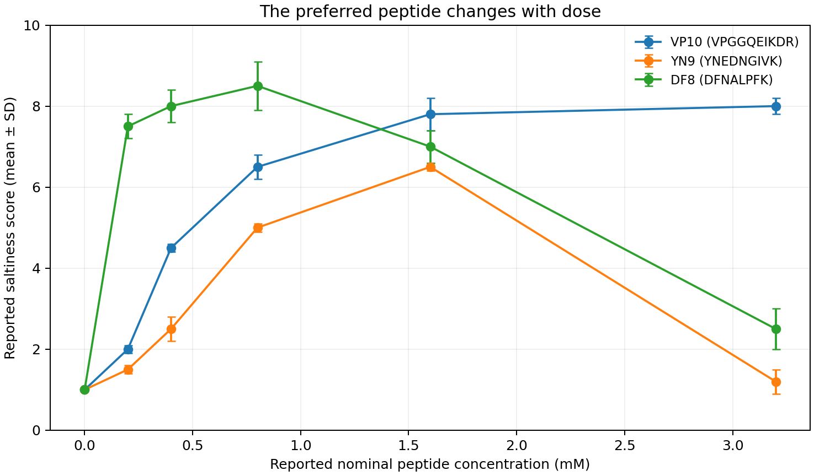

# Findings and figures

[Project overview](../README.md) · [Research status](RESEARCH_STATUS.md) · [Shared data](../data/README.md)

Four completed computational experiments follow one research question: what evidence is needed before using a model to select a saltiness enhancer? The figures below show the retained findings; each links to the complete report and underlying result tables.

## 01 · CaSR models and docking

Model transfer remains inaccurate and reference-pose ranking is weak.

[Report](../experiments/01-casr-models-and-docking/README.md) · [Tables and figure guide](../experiments/01-casr-models-and-docking/results/README.md)

## 02 · Sensory source transfer

Reference-held-out performance is unstable; random splits overstate the tested pipeline’s usefulness.

[Report](../experiments/02-sensory-source-transfer/README.md) · [Tables and figure guide](../experiments/02-sensory-source-transfer/results/README.md)

## 03 · Assay conditions and dose

Standalone taste and enhancement differ, and published rankings reverse with dose.

[Report](../experiments/03-assay-dose-response/README.md) · [Tables and figure guide](../experiments/03-assay-dose-response/results/README.md)

## 04 · TRPV1 membrane access

The contacts lie in a membrane/cytoplasmic region; access and function remain untested.

[Report](../experiments/04-trpv1-membrane-access/README.md) · [Tables and figure guide](../experiments/04-trpv1-membrane-access/results/README.md)

## What follows

The current evidence does not validate a new salt enhancer. The next research task is to identify condition-matched sensory and functional evidence that distinguishes direct receptor modulation from other explanations. A literature finding remains attributed to its authors; any new calculation must state what it adds.
