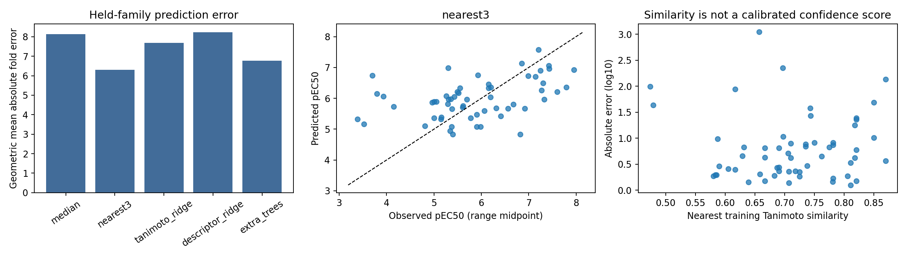

# 01 · CaSR models and docking

[Project](../../README.md) · [Experiments](../README.md) · [Results](results/README.md) · [Code](code/README.md) · [Data](../../data/README.md)

**Question:** Can receptor-activity prediction and docking reliably prioritize new analogues?

**Completed result:** Model transfer remains inaccurate and reference-pose ranking is weak.

Research and analysis by **Ratchanon Preecha**. This project evaluates whether published calcium-sensing receptor (CaSR) measurements and a ligand-bound structure can support prioritization of unmeasured γ-glutamyl analogues. Saltiness enhancement is the longer-term question; it is not the endpoint predicted here.

**Start here:** [Executed notebook](CaSR_Research_Workbench.ipynb) · [Open in Colab](https://colab.research.google.com/github/preecharatchanon-arch/Ratc/blob/main/projects/salt-casr/experiments/01-casr-models-and-docking/CaSR_Research_Workbench.ipynb) · [Complete run package](../../archives/CaSR_Notebook_Run.zip) · [Readable source](code)

[All experiments](../../README.md) · [Shared CaSR data](../../data/README.md#casr-chemistry)

## What the notebook does

| Analysis | Scope |
| --- | --- |
| Chemical reconstruction | 94 table-compound graphs; explicit linkages and stereochemistry; eight unsupported structures listed |
| Assay curation | 58 numerical/range HEK-293 EC₅₀ entries; missing, inactive and censored labels remain distinct |
| Chemical generalization | Five fixed methods; **26 constitutional middle-residue groups**, holding L/D and allo forms together |
| Source sensitivity | Journal and earlier patent assignments analysed separately; not extra independent measurements |
| Chemical proposals | 22 combinations absent from the extracted series; forecasts and rank sensitivity, not validated hits |
| Docking | 20 compounds, including measured analogues and controls, plus a larger native-ligand reference search |

The independent source audit matched **103 original table rows** to 102 unique labels without a HEK-293 value mismatch. Eighteen additional named inactive peptides from two prose lists are supplied separately: their sentences do not specify the assay system or a detection limit. They are not assigned artificial EC₅₀ values or merged into the regression target. This is a table-based quantitative dataset, not an exhaustive literature database.

## Results and limits

The lowest observed held-family MAE is **0.799 log₁₀ units**, equivalent to **6.29-fold geometric mean absolute error**. Only about 41% of that model's predictions are within threefold. The descriptive family bootstrap does not establish a reliable improvement over the median comparator. The model was selected after comparison; this is not external-study validation.

Docking score/activity Spearman association is **0.24 across 14 measured compounds** in a selected panel. Native top-pose RMSD is **4.78 Å**; the larger-search top pose is **4.44 Å**, with the closest returned pose at **2.43 Å**. RMSD is computed in the receptor frame without aligning away the displacement. These results provide weak support for this preparation/scoring protocol's structural prioritization. Inactive in a functional assay does not necessarily mean nonbinding.



The proposed Nva–L-lactic ester is an **unmeasured combination within an explicitly described patent scaffold**. No global novelty, receptor activity, food suitability or saltiness enhancement is established. The useful outputs are auditable structures, measured chemical comparisons, failure examples and defined comparators for independent experiments.

Two numerical/range labels remain outside the regression because their monomers were not implemented in the assembler: γ-Glu-Pen-Gly and γ-Glu-Cys(1,2-dicarboxyethyl)-Gly. This is an implementation exclusion, not a claim that both chemical identities are intrinsically undefined.

## Run and inspect

Open the notebook in Colab, choose **CPU**, and select **Run all**. Inputs and source are embedded; no upload or API key is needed. Workers use an isolated Python 3.12 environment with pinned binary packages. The default protocol uses two CPU threads and seed 777. A complete reviewed local run took approximately four minutes; allow 15–25 minutes on a fresh Colab runtime, depending on hardware and network.

`RUN_DOCKING=False` inspects explicitly labelled archived results without overwriting current pose files. Cached stages verify output hashes and the actual environment/configuration. The displayed docking settings are passed to the workers. Native geometry optimization convergence is recorded per calculation.

For local execution on Linux with Python 3.12 and uv, run these commands from this experiment folder:

```sh
uv venv --python 3.12 .venv
uv pip install --python .venv/bin/python --only-binary :all: -r requirements_locked.txt
.venv/bin/python code/benchmark.py
.venv/bin/python code/prepare_receptor.py
.venv/bin/python code/docking.py
.venv/bin/python code/native_search_sensitivity.py
```

These commands write fresh outputs below `runs/latest/`; `results/` retains the reviewed snapshot. The notebook also generates figures, descriptive uncertainty analyses and a results ZIP.

## Verification record

[REVIEW_CHECKS.json](verification/REVIEW_CHECKS.json) records source-value comparison, stereochemical grouping, independent EC₅₀-ratio error calculation, pose-RMSD recalculation, configuration agreement, cache invalidation, archived/current transitions and actual fresh bootstrap without preinstalled uv. All checks passed. Every code cell completed in sequential Python execution with IPython rich-display capture; **the Colab browser interface itself was not exercised**. This is evidence for the tested workflow, not a guarantee of zero defects on every machine.

This reviewed grouping replaces an earlier 28 name-based grouping that separated Ile/allo-Ile and Thr/allo-Thr. The earlier MAE was 0.784; the reviewed value is 0.799. Historical docking outputs in `../../archives/casr-prior-reference/` use different package versions and are labelled separately.

## Sources

1. Amino Y, et al. (2016). *Structure–CaSR–Activity Relation of Kokumi γ-Glutamyl Peptides*. Chemical and Pharmaceutical Bulletin 64(8), 1181–1189. [DOI](https://doi.org/10.1248/cpb.c16-00293); [2017 erratum](https://doi.org/10.1248/cpb.c17-e6506).
2. Eto Y, Amino Y. *Kokumi-imparting agent*. [US20100136197A1](https://patents.google.com/patent/US20100136197A1/en), published 3 June 2010.
3. Yamaguchi H, et al. (2025). *Cryo-EM structure of the calcium-sensing receptor complexed with the kokumi substance γ-glutamyl-valyl-glycine*. Scientific Reports 15, 3894. [DOI](https://doi.org/10.1038/s41598-025-87999-1); [PDB 9J7I](https://www.rcsb.org/structure/9J7I).
4. Miyaki T, et al. (2015). *Effect of a kokumi peptide, γ-glutamyl-valyl-glycine, on the sensory characteristics of chicken consommé*. Flavour 4, 17. [DOI](https://doi.org/10.1186/2044-7248-4-17).

[Source notes](../../data/casr/source_notes.json), [original-value audit](../../data/casr/source_table_audit.json) and [original notebook input hashes](verification/ORIGINAL_INPUT_MANIFEST.json) accompany the curated data. Full publisher articles and patent text are not redistributed. Third-party material retains its original terms and attribution; repository access does not create a new licence for it.

Repository scripts read shared inputs from `../../data/casr/` and write fresh outputs to `runs/latest/`. The executed notebook retains its self-contained, reviewed inputs and code. The code relocation changes file paths only; `verification/REVIEW_CHECKS.json` refers to that unchanged notebook.
