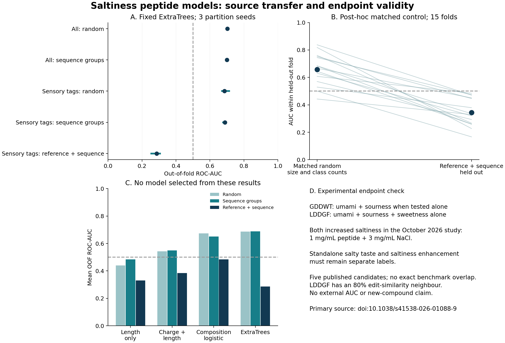

# 02 · Sensory source transfer

[Project](../../README.md) · [Experiments](../README.md) · [Results](results/README.md) · [Code](code/README.md) · [Data](../../data/README.md)

**Question:** Do fixed sequence models retain their accuracy across literature-source groups?

**Completed result:** Reference-held-out performance is unstable; random splits overstate the tested pipeline’s usefulness.

Research and analysis by **Ratchanon Preecha**, 15 October 2026.

**Result:** our fixed sequence-based ExtraTrees baseline reaches about 0.69 ROC-AUC in sensory-tagged records when splitting by sequence similarity, but fails to transfer under reference-connected holdout. This supports auditing endpoints and primary sources before computationally ranking new saltiness enhancers.

This continuation moves from the earlier CaSR-potency experiment to published saltiness-related measurements. **It is an independent baseline analysis, not a reproduction or external test of SaltyMeta's released ESM2 model.** It does not establish a new compound, receptor mechanism, sensory effect or food-use suitability.

**Open:** [Executed Colab notebook](Saltiness_Sensory_Validation.ipynb) · [Run in Colab](https://colab.research.google.com/github/preecharatchanon-arch/Ratc/blob/main/projects/salt-casr/experiments/02-sensory-source-transfer/Saltiness_Sensory_Validation.ipynb) · [Full result figure](results/evidence_and_transfer.png) · [Individual fold predictions](results/out_of_fold_predictions.csv).

## What was tested

The unchanged supplementary workbook from Chen et al., **SaltyMeta, arXiv:2609.16809v1**, contains 580 canonical-sequence records: 280 positives and 300 negatives. Its positive endpoint combines standalone salty taste and saltiness enhancement, with heterogeneous evidence. We preserve the supplied labels and metadata rather than pretending they are all equivalent experiments.

Two cohorts are analysed: all 580 records, and 251 records selected by the source curator's sensory tags (138 positives, 113 A1/B1 negatives). The tags are not our independent confirmation of all original assays. Most B1 negatives lack standalone salty taste under their source condition; this is not established absence of enhancement in NaCl.

Four models were fixed before looking at predictions: length-only logistic, charge/length logistic, 28-feature composition/physicochemical logistic, and ExtraTrees (512 trees, minimum leaf 2). No embedding or hyperparameter search was performed. The [initial protocol](PROTOCOL.md) and [post-hoc diagnostic plan](POSTHOC_DIAGNOSTICS.md) remain separate.

Five-fold evaluations use three partition seeds. Similarity groups connect sequences with normalized edit similarity at least 0.80. Reference-and-similarity groups additionally connect records sharing DOI-like tokens. This prevents those tokens crossing folds but is not perfectly reconstructed primary-study independence: metadata include secondary reviews and incomplete references. All source and similarity definitions are in [analyse.py](code/analyse.py).

## Results

| Cohort / evaluation | Fixed ExtraTrees mean OOF ROC-AUC | Across three partition seeds |
| --- | ---: | ---: |
| All 580 / random | 0.703 | 0.698–0.707 |
| All 580 / similarity groups | 0.701 | 0.700–0.701 |
| Sensory-tagged 251 / random | 0.686 | 0.671–0.713 |
| Sensory-tagged 251 / similarity groups | 0.689 | 0.678–0.696 |
| Sensory-tagged 251 / reference + similarity groups | 0.286 | 0.255–0.306 |
| Post-hoc reference-parsing sensitivity | 0.415 | 0.395–0.449 |

ROC-AUC 0.5 corresponds to chance ranking. These results do not justify inverting scores or claiming that every ML method fails: the full composition logistic model is approximately chance (0.484) under the original reference grouping. They show unstable transfer in the fixed pipelines tested here. No model is selected after inspecting this table.



The reference split creates uneven fold sizes and class proportions. A **post-hoc matched control** therefore samples random test sets of the same size and class counts for each original reference fold. Mean within-fold AUC is **0.658 for matched random versus 0.344 for reference holdout** across 15 paired folds. The reference result is lower in all 15 comparisons. Those overlapping draws are not independent trials and do not supply a 15-trial significance test. The difference remains sensitive to domain shift and source construction; it is not causal proof of leakage.

A second sensitivity removes selected verified reviews/prediction-study references and visibly incomplete or malformed DOI tokens. Reference groups increase from 34 to 53, the largest group decreases from 66 to 28 records, and 15 records lack a remaining reference and retain similarity grouping only. AUC remains 0.395–0.449. Remaining sources have not all been independently verified; this is a diagnostic rather than a definitive external benchmark.

The [bootstrap](results/bootstrap.json) resamples source clusters of averaged repeated OOF predictions. It is descriptive and conditional on existing fits. Its estimand differs from the mean of the three seed-level AUCs in the table; it is not a retraining or external-validation confidence interval. [Every metric and split](results/) is retained, including the weaker baselines and the exact predictions.

## The endpoint issue has an experimental example

Kong et al. published five synthesized mushroom peptides on **2 October 2026**, after the benchmark preprint. We inspected the accepted primary manuscript, Table 1, the sensory methods and the supplementary time-intensity table.

| Peptide | Standalone taste descriptors in Table 1 | Response when added to NaCl |
| --- | --- | --- |
| GDDWT | Umami, sourness | Significant saltiness increase reported |
| LDDGF | Umami, sourness, sweetness | Significant saltiness increase reported |
| ASHGEGF | Umami, sourness, saltiness | Significant saltiness increase reported |

The reported enhancement experiment used **1 mg/mL peptide with 3 mg/mL NaCl**. Absence of a standalone salty descriptor should therefore not be treated as a negative enhancement label. This is an existing experimental result, not a new biological discovery from our analysis. It supplies a concrete reason to separate the targets.

All five published candidates lack exact benchmark matches, but **LDDGF is 80% edit-similar to LDGF**. They are also author-selected candidates, and the two less-pronounced effects are not assigned definite negative labels here. We therefore report [individual scores](results/literature_panel_scores.csv), not an external AUC or success-rate estimate. Scores are from our fixed baselines and are not calibrated enhancement probabilities. Taste-recognition thresholds are kept separate from enhancement measurements and are not receptor EC50 values.

The [2017 arginyl-dipeptide cellular comparison](results/arginyl_cellular_controls.csv) is also retained separately: AR, RA and RP increased NaCl-elicited human taste-cell responses; RE, ER, DD and ED did not in that experiment. Some are present in the combined benchmark under other endpoint/context evidence. These are neither new independent classifier tests nor grounds for silently changing sensory labels.

## Research decision

The next useful dataset should represent **a peptide under an assay condition**, with separate fields for standalone salty taste, enhancement over a specified NaCl control, receptor/cellular response, concentration, pH, matrix and counterion information. A negative label for one endpoint does not automatically transfer to another.

The immediate controls are GDDWT/LDDGF/ASHGEGF for direct sensory enhancement, and AR/RA/RP versus RE/ER/DD/ED for the separate human taste-cell mechanism. Existing CaSR gamma-glutamyl measurements remain their own series. Canonical one-letter sequences do not encode gamma linkages or distinguish all chemical stereoisomers; this model must not be used to score the proposed Nva ester as an ordinary peptide sequence.

This finding changes the computational plan: **curate assay-specific evidence and test source transfer before virtual digestion or broad candidate screening**. It does not show that CaSR is irrelevant or establish peptide binding to TMC4 from docking.

[All experiments](../../README.md) · [Shared saltiness data](../../data/README.md#saltiness-and-assay-conditions)

## Run and verify

Open the notebook in Colab, select CPU and Run all. Inputs and source are embedded. Workers run in isolated Python 3.12 with 19 pinned distributions and `MPLBACKEND=Agg`; no source compilation, external API key, GPU or historical upload is required. Each run recomputes the fixed models and diagnostics. Setup needs internet access for package installation.

For local Linux execution with Python 3.12 and uv:

```sh
uv venv --python 3.12 .venv
uv pip install --python .venv/bin/python --only-binary :all: -r requirements_locked.txt
.venv/bin/python code/analyse.py
.venv/bin/python code/diagnose.py
.venv/bin/python code/report.py
```

The reviewed standalone primary analysis took about 51 seconds; post-hoc diagnostics took about 18 seconds on the available CPU. Fresh-runtime setup and Colab hardware can add several minutes. The executed notebook records its own environment and actual elapsed time. Validation uses sequential plain-Python execution with IPython rich-display capture; the Colab browser interface itself is not tested.

[verification.json](results/verification.json) records 60 recomputed metric rows, 22,956 OOF predictions, one prediction per record/model/split/seed, and no reference-token crossover in the reference-grouped evaluation. Code for the matched controls and reference sensitivity is in [diagnose.py](code/diagnose.py); figure generation and metric checks are in [report.py](code/report.py).

## Sources and data attribution

1. Chen W, Li W, He Y, Yang Y. *SaltyMeta: a curated benchmark and protein language model-informed web tool for salty peptide prediction*. arXiv:2609.16809v1, 15 September 2026. [Paper](https://arxiv.org/abs/2609.16809v1), [original supplementary workbook](https://arxiv.org/src/2609.16809v1/anc/SaltyMeta_Supplementary_Data.xlsx), [authors' model platform](https://github.com/chenwanchao/saltymeta-prediction-platform). The included workbook is unchanged. The arXiv release is [CC BY-SA 4.0](https://creativecommons.org/licenses/by-sa/4.0/); retain that attribution and licence for source data and derivatives. It does not change the repository's code licence.
2. Kong W, Lin L, Lai L, et al. *Discovery of saltiness-enhancing peptides from Hypsizygus marmoreus via virtual screening, multisensory evaluation, electronic tongue, and molecular simulation*. npj Science of Food, published 2 October 2026, article in press. [DOI](https://doi.org/10.1038/s41538-026-01088-9). Primary Table 1, QDA/TI methods and supplementary Table S2 were inspected. Full publisher files are not redistributed.
3. Xu JJ, Elkaddi N, Garcia-Blanco A, et al. *Arginyl dipeptides increase the frequency of NaCl-elicited responses via epithelial sodium channel alpha and delta subunits in cultured human fungiform taste papillae cells*. Scientific Reports 7, 7483 (2017). [DOI](https://doi.org/10.1038/s41598-017-07756-x).

[SOURCE_MANIFEST.json](SOURCE_MANIFEST.json) records retrieval URLs, date, hashes and use. The public source workbook is supplied in [shared data](../../data/saltiness/saltymeta_supplement.xlsx). The executed notebook embeds the original package layout; repository scripts use the shared copy. Downloaded publisher manuscripts, supplementary articles and intermediate HTML are excluded.

Run local commands from this experiment folder. Fresh script outputs go to `runs/latest/`; `results/` is the retained reviewed snapshot. `verification/ORIGINAL_FILE_HASHES.json` describes the original release layout, while the repository-wide checksum index describes the organized release.
