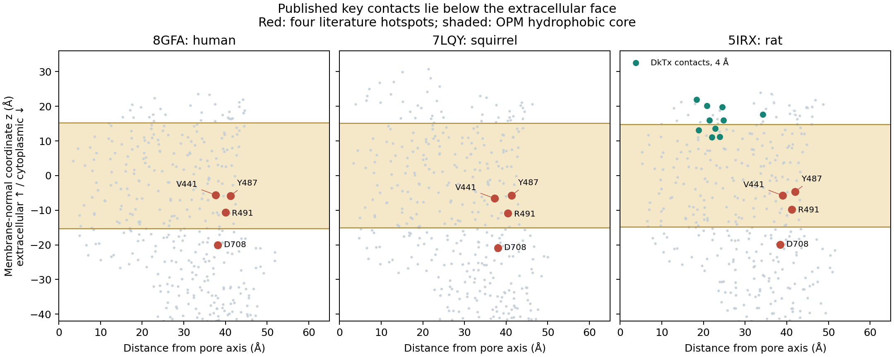

# 04 · TRPV1 membrane access

[Project](../../README.md) · [Experiments](../README.md) · [Results](results/README.md) · [Code](code/README.md) · [Data](../../data/README.md)

**Question:** Is a proposed peptide-contact site positioned for rapid extracellular action?

**Completed result:** The contacts lie in a membrane/cytoplasmic region; access and function remain untested.

Research and analysis by **Ratchanon Preecha**, 15 October 2026.

**Result:** the four key TRPV1 residues nominated by a salty-peptide docking study
map to the inner half of the membrane or the cytoplasmic side in three experimental
structures. Three of those residues directly contact resolved phospholipids in
human TRPV1. That site needs an access mechanism before it can be used to screen
peptides intended to act rapidly from the mouth-facing extracellular solution.

This is a structural reanalysis, **not** a demonstration that the reported peptides
cannot enhance saltiness, cannot affect TRPV1, or were measured incorrectly.

[Analysis code](code/analyse_access.py) · [Protocol](PROTOCOL.md) · [Individual coordinates and classifications](results/published_contact_depths.csv) · [Independent distance checks](results/independent_lipid_distance_check.csv) · [Run record](results/run_receipt.json)

## Why this question follows our earlier results

Our ENaC docking work did not recover the experimentally supported S3969 pocket
reliably. The [sensory source-transfer experiment](../02-sensory-source-transfer/README.md) and
[assay/dose analysis](../03-assay-dose-response/README.md) then found weak model transfer and
endpoint-dependent labels. A new receptor screen needs a stronger biological
foundation than a favourable score or a stable simulation.

Ren et al. [1] report four principal TRPV1 contacts for salty peptides:
**Val441, Tyr487, Arg491 and Asp708**, within an eleven-residue major-contact set.
Their human homology model used squirrel TRPV1 structure 7LQY as template.
We ask where those contacts actually sit relative to a membrane, rather than
rerunning their docking or selecting more peptides on its score.

## Experimental structures and comparators

| Structure | Role in this analysis | Important limitation |
| --- | --- | --- |
| Human **8GFA**, 2.29 Å | Direct human sequence and resolved phospholipids; antagonist SB-366791 complex [2] | Inhibited state, not a salty-peptide complex |
| Squirrel **7LQY**, 3.19 Å | The original docking paper's actual template [3] | A different species; transferred sites require sequence alignment |
| Rat **5IRX**, 2.95 Å | Actual bound peptide agonist **DkTx**, with RTX, in lipid nanodiscs [4] | Truncated construct and activated complex; not a taste experiment |

We use the unchanged experimental coordinates and the Orientations of Proteins in
Membranes (**OPM**) versions of the same structures [5]. OPM estimates hydrophobic-core
boundary planes; these planes are calculated, not directly observed membrane surfaces.
The positive z direction is assigned to the extracellular side using channel topology
and checked against the observed DkTx position.

## Quantitative result

Human 8GFA, chain A; z = 0 is the OPM membrane centre and the extracellular
hydrophobic-core boundary is at **+15.3 Å**. Distances below that boundary are
membrane-normal separations, not a calculated travel path or permeability barrier.

| Published contact | Cα z, Å | Below extracellular core boundary, Å | Nearest resolved phospholipid atom, Å |
| --- | ---: | ---: | ---: |
| Val441 | −5.60 | 20.90 | 3.42 |
| Tyr487 | −5.83 | 21.13 | 2.90 |
| Arg491 | −10.64 | 25.94 | 2.58 |
| Asp708 | −20.02 | 35.32 | 6.16 |

The first three Cα atoms lie within the hydrophobic-core slab; Asp708 is below
the cytoplasmic boundary. Their nearest phospholipid distances are calculated
from the actual resolved lipid atoms, not from a membrane cartoon.

After sequence alignment, the corresponding residues occupy the same general
region in the squirrel template and rat structure. Importantly, human Asp708
maps to **rat Asp707**, while human Val441 maps to **rat Val440**. Reusing residue
numbers without checking their identities would compare the wrong sites.

Across all eleven major contacts, all four receptor chains and all three
structures, **none of their Cα atoms lies above the extracellular core boundary**.
That remains true when the membrane centre and half-thickness are each changed
by −3, 0 or +3 Å. For the four key contacts, even their highest resolved heavy
atom remains below that boundary in every tested scenario.

The three structures and their symmetric chains are **not independent biological
replicates**. This is a robustness check on site geometry, not a significance test.



## A real peptide comparator prevents an overbroad conclusion

DkTx is a peptide agonist with an experimentally resolved TRPV1 complex [4]. In
5IRX, its receptor contacts at a 4 Å heavy-atom cutoff involve **14 unique rat
positions**. Their Cα z values range from **+7.26 to +21.92 Å**, at the outer
membrane/pore region. DkTx itself partly penetrates the outer membrane interface:
peptides are therefore not categorically excluded from membrane-associated sites.

In that same rat structure, the nearest DkTx atom is **24.3–34.9 Å** from the
mapped four salty-peptide hotspots. Thus, the proposed salty-peptide contact set
does not describe the experimentally observed DkTx interface. It could describe
another site, but that requires its own access and functional evidence.

The human antagonist SB-366791 provides another useful check: the four key
contacts are **13.0–15.9 Å** from its nearest resolved atom. We therefore do **not**
call the salty-peptide site identical to the antagonist's vanilloid-binding site.
Ligand distances, including phospholipids, detergent and water, are exported
separately at 3.5, 4.0 and 5.0 Å contact cutoffs.

## We also checked evidence against a simple exclusion rule

Added after the structural analysis, a different primary study [6] reports that
short peptides QFF, LDIF and FFR reduce capsaicin-associated calcium fluorescence
in HaCaT cells. At 200 μM and 24 h pretreatment, the reported reductions are
66.8%, 73.1% and 72.4%, respectively. The study also predicts contacts involving
some of the same TRPV1 residues. This is useful competing evidence that small
peptides can alter a TRPV1-associated cellular response.

It does not settle our question: the study uses hours-long pretreatment and a
cellular calcium endpoint, rather than rapid extracellular channel-current
measurements or proof of a specific binding pose. These inhibitory-response
observations are kept in a [separate post-hoc evidence table](../../data/trpv1/posthoc_alternative_evidence.csv),
not labelled as negative saltiness examples or pooled with sensory measurements.
Reported error terms are retained without assuming their SD/SEM convention.

## What this supports, and what remains untested

**Supported by our calculations:** the reported contact identities refer to a
membrane/cytoplasmic region; three key residues have resolved lipid neighbours;
the geometry is preserved across the chosen structures and boundary scenarios;
the experimentally bound DkTx interface is elsewhere.

**Not established:** the original docking pose's exact lipid overlap, an absence
of aqueous access, peptide permeability or uptake, an activation/inhibition
mechanism, taste enhancement through TRPV1, or food suitability. The original
peptide poses and membrane-transport measurements are unavailable here. A site
within a membrane can still be reached through an aqueous cavity; z position
alone cannot exclude that possibility. Symmetry, missing loops, receptor state,
lipid composition and human/rodent differences also limit interpretation.

The four salty peptides have calculated free-form molecular weights of
839–1469 Da and topological polar surface areas of 315–641 Ų. These descriptors
explain why membrane access warrants investigation; **they are not permeability
predictions**. The approximate pH-dependent charges use fixed aqueous pKa values,
and neutral-graph logP is not logD. No small-molecule absorption cutoff is used
to reject a peptide.

## Research decision

**Do not launch a broad oral-peptide screen at this TRPV1 site yet.** The result
adds a biological condition that docking scores omit: a ligand needs an access
route on the relevant timescale. It does not establish ENaC or CaSR as the
alternative mechanism, and it does not weaken the authors' sensory observations
merely because their proposed receptor mechanism needs further testing.

The next discriminating experiment is **side-specific, rapid functional testing**:
does an externally applied taste-active peptide change current in cells expressing
human TRPV1, at matched NaCl and pH, compared with mock-expressing cells? Compare
external application with cytoplasmic access where experimentally feasible, and
use established agonist/antagonist controls. A slow calcium change after many
hours would answer a different question. DkTx is a venom-derived mechanistic
comparator; it is not proposed as a taste ingredient.

For the salt-reduction project, the complete six-candidate sensory panel from our
previous analysis remains a better starting set than a list of top docking hits.
First establish reproducible concentration-dependent enhancement; then use a
functional assay to identify which receptor, if any, mediates it. That creates
a testable bridge between food-level observations and molecular modelling.

This is a new result **within our project**. We have not established that the
membrane-access observation is globally novel or publishable as a standalone finding.
No new molecule or independently measured biological result is claimed.

[All experiments](../../README.md) · [Shared structural inputs](../../data/README.md#trpv1-structure-inputs)

## Reproduce and inspect

The analysis has already been run; **another Colab run is not required to inspect
these results**. The readable code, input hashes, canonical sequence snapshots,
all residue mappings and outputs are provided here. No API key or GPU is needed.
The computational analysis takes seconds; downloading original coordinate files
is the main setup cost.

A fresh isolated Python 3.12 reproduction, including installation of the 21
pinned packages, completed successfully in **80.5 seconds locally**. Its
[execution record](verification/EXECUTION_RECORD.json) is separate from the already verified
Colab sensory-analysis export. This structural analysis was not run in Colab.

With Python 3.12 and the pinned packages installed:

```sh
python code/download_inputs.py
python code/analyse_access.py
python code/verify_sources.py
```

The downloader verifies existing files, copies exact supplied sequence snapshots,
and retrieves the six coordinate files with SHA-256 checks. A changed upstream
file causes an explicit source-version error rather than a silent replacement.
Full article HTML inspection copies are not redistributed. The source-paragraph
check in `verify_sources.py` is available when that inspection text is present;
the original-coordinate distance check is reproducible from downloaded inputs.

The OPM versus deposited Cα geometry agrees after rigid alignment to **<0.001 Å
RMSD** in all three structures. A separate calculation directly from the original
human mmCIF reproduces all four lipid distances within **0.0005 Å**. The eleven
source residue identities were also checked against the original Results paragraph.
These checks validate our mapping and arithmetic; they do not validate peptide binding.

Canonical sequence snapshots are attributed to UniProtKB under its
[CC BY 4.0 terms](https://www.uniprot.org/help/license). Coordinate sources and OPM
attribution are recorded in [INPUT_MANIFEST.json](../../data/trpv1/INPUT_MANIFEST.json). The original
coordinates and publisher articles are not bundled here; analysis code retains
the repository's academic-review terms.

## Sources

1. Ren H, et al. (2024). *Identification and virtual screening of novel salty peptides from hydrolysate of tilapia by-product by batch molecular docking.* Frontiers in Nutrition 10, 1343209. [DOI](https://doi.org/10.3389/fnut.2023.1343209). Methods 2.4; Results 3.4. A saltiness study, not direct channel-current validation of those four peptides.
2. Neuberger A, et al. (2023). *Human TRPV1 structure and inhibition by the analgesic SB-366791.* Nature Communications 14, 2451. [DOI](https://doi.org/10.1038/s41467-023-38162-9); [8GFA](https://www.rcsb.org/structure/8GFA).
3. Nadezhdin KD, et al. (2021). *Extracellular cap domain is an essential component of the TRPV1 gating mechanism.* Nature Communications 12, 2154. [DOI](https://doi.org/10.1038/s41467-021-22507-3); [7LQY](https://www.rcsb.org/structure/7LQY).
4. Gao Y, Cao E, Julius D, Cheng Y (2016). *TRPV1 structures in nanodiscs reveal mechanisms of ligand and lipid action.* Nature 534, 347–351. [DOI](https://doi.org/10.1038/nature17964); [5IRX](https://www.rcsb.org/structure/5IRX). PDB links an alternative later re-refinement, 9OGK; we retain the original DkTx-containing 5IRX model for its directly resolved toxin interface, not a claim of unique atomic truth.
5. Lomize MA, et al. (2012). *OPM database and PPM web server: resources for positioning of proteins in membranes.* Nucleic Acids Research 40, D370–D376. [DOI](https://doi.org/10.1093/nar/gkr703). Calculated hydrophobic-core boundaries, not measured peptide accessibility.
6. *Identification of TRPV1-Inhibitory Peptides from Takifugu fasciatus Skin Hydrolysate and Their Skin-Soothing Mechanisms.* Marine Drugs (2025) 23, 196. [DOI](https://doi.org/10.3390/md23050196). Results 2.3, Figure 2; post-hoc competing evidence, not pooled with the planned structural analysis.

Run local commands from this experiment folder. Canonical sequence snapshots and the download manifest are in `../../data/trpv1/`. Downloaded coordinates go to `../../data/trpv1/cache/`, which is ignored by Git. Fresh analysis outputs go to `runs/latest/`; the committed `results/` remain the reviewed snapshot.
