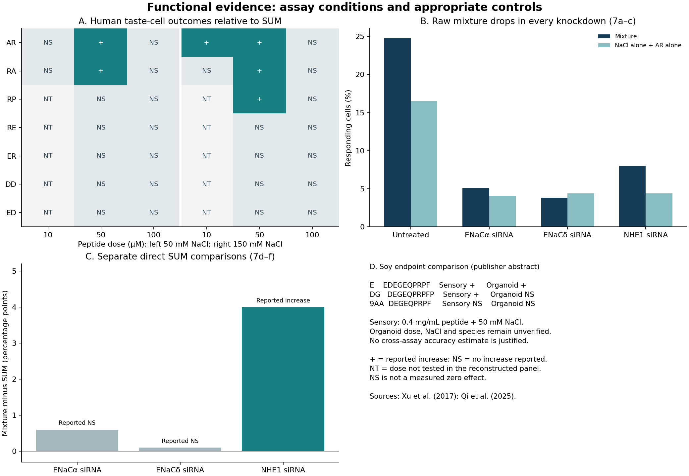

# 05 · Functional assay controls

[Project](../../README.md) · [Experiments](../README.md) · [Results](results/README.md) · [Code](code/README.md) · [Data](../../data/functional/README.md)

**Question:** which functional evidence should determine the next peptide comparison, and which readouts could mislead us?

**Completed result:** the published human taste-cell panel has 32 explicitly tested peptide-dose/NaCl combinations, with six reported increases over the authors’ SUM comparator. All seven peptides elicit peptide-alone cellular responses, but only AR, RA and RP increase NaCl-related responses in any of these tested conditions. A separate soy study reports sensory enhancement for both E and DG, while only E enhances its tested organoid response.

Research reanalysis by **Ratchanon Preecha**, 15 October 2026. These are attributed published observations, not biological discoveries or experiments performed by us. This follow-up expands the seven-row cellular comparator table in Experiment 02 into assay-condition records and checks how baseline changes affect mechanistic interpretation. No new ML fitting or docking was performed.

## Read the figure



**SUM** is the original authors’ arithmetic sum of responses to peptide alone and NaCl alone. It is an assay reference, not a fitted interaction model or a probability of receptor binding. **NS** means no increase was reported as significant; it does not mean a measured effect of zero. **NT** marks untested doses.

## 1. A cellular EC50 is not an enhancement EC50

Xu et al. [1] report peptide-alone cellular EC50 values for all seven dipeptides, ranging from 45 to 122 μM. Yet RE, ER, DD and ED do not increase the NaCl-related response at the two peptide doses and two NaCl stimuli tested for them. A screen that selects compounds only because they elicit a calcium response would retain candidates that fail the enhancement comparison in this panel.

The complete condition table retains AR/RA at 10, 50 and 100 μM, and the other five peptides at 50 and 100 μM, each with reported 50 and 150 mM NaCl stimuli. There are **32 conditions, not 32 molecules or independent biological replicates**.

| Peptide | Tested peptide doses, μM | Conditions with a reported increase over SUM |
| --- | --- | --- |
| AR | 10, 50, 100 | 50 μM at both NaCl stimuli; 10 μM at 150 mM NaCl |
| RA | 10, 50, 100 | 50 μM at both NaCl stimuli |
| RP | 50, 100 | 50 μM at 150 mM NaCl |
| RE, ER, DD, ED | 50, 100 | None reported in these tested conditions |

At **100 μM**, none of the seven peptides has a reported increase across the 14 tested peptide/NaCl combinations. Thus, a single 100 μM condition would miss the reported enhancement conditions of AR, RA and RP. This is a design warning within this selected panel, not an estimated failure rate for future compounds.

Importantly, the paper cautions that the SUM reference itself is not monotonic. A change from significant to non-significant does **not** establish a significant difference between doses or prove a bell-shaped biological mechanism. The published sensory curves in Experiment 03 and this cellular significance pattern are separate observations.

## 2. Raw suppression can misidentify the relevant pathway

In Figure 7a–c, the mixture response drops from 24.8% in untransfected cells to 5.1%, 3.8% and 8.0% after ENaCα, ENaCδ and NHE1 knockdown, respectively. A comparison of raw mixture responses alone would flag all three interventions, because the NaCl-alone baseline also changes substantially.

The paper’s **separate Figure 7d–f experiments** directly compare mixture with SUM:

| Knockdown | SUM, % cells | Mixture, % cells | Calculated excess, percentage points | Authors’ comparison |
| --- | ---: | ---: | ---: | --- |
| ENaCα | 3.8 | 4.4 | 0.6 | Not significant |
| ENaCδ | 4.4 | 4.5 | 0.1 | Not significant |
| NHE1 | 5.1 | 9.1 | 4.0 | Significant increase |

NHE1 knockdown lowers the raw mixture response in the first cohort but preserves a reported increase over SUM in the direct comparison. This demonstrates why our proposed assay must retain **peptide-only, NaCl-only and mixture conditions under each perturbation**. A reduction in the raw mixture response is insufficient to attribute loss of enhancement to a receptor.

The two sets of panels use different reported cell totals. We keep them separate and do not borrow a component baseline from 7a–c for a mixture in 7d–f. Cell-count-based arithmetic is provided as a rounding check, not a new p-value or a biological-replicate analysis. The original significance statements are preserved.

The pharmacology points in the same direction: the reported mixture-minus-SUM contrast is 6.2 percentage points without amiloride and 0.6 with it, with an increase reported only without the blocker. Together with knockdown, this supports an ENaC-dependent contribution in this culture system. It does not locate an AR binding pocket, establish direct binding, or demonstrate that ENaC is the sole pathway.

## 3. A sensory enhancer can fail a particular cellular readout

Qi et al. [2] compare three closely related sequences:

| Name | Sequence | Reported sensory effect | Reported amiloride-insensitive organoid effect |
| --- | --- | --- | --- |
| E | EDEGEQPRPF | Enhancement | Enhancement |
| DG | DEGEQPRPFP | Enhancement | No enhancement reported |
| 9AA | DEGEQPRPF | No enhancement reported | No enhancement reported |

E adds an N-terminal glutamate to the 9AA core; DG adds a C-terminal proline. This gives us a published matched series with distinct endpoint patterns. The comparison does not isolate terminal position from residue identity or establish a general structure–activity rule.

At the reported sensory condition of **0.4 mg/mL peptide with 50 mM NaCl**, E and DG correspond to 61.4 and 54.78 mM NaCl intensity, respectively. Calculated increases in equivalent intensity are **22.8% and 9.56%**. They are not demonstrated sodium-reduction percentages at a lower starting salt concentration.

**Access limit:** the publisher abstract and supporting-information description were available; the full methods and data were not obtained. Organoid peptide dose, NaCl background, species and sampling details remain unverified and are blank in the input table. Therefore, this is an endpoint discrepancy reported in the same study, not proof that matched sensory and cellular conditions disagree or a numerical false-negative rate. The abstract reports simulated TMC4 interactions; that does not establish direct peptide binding. We do not extrapolate its transcript observations into a general statement about human taste cells.

## Focused follow-up: charge-matched controls

The [arginyl starting-point note](../../docs/ARGINYL_STARTING_POINT.md) examines the selected panel’s charge confounding, defines AR/AK and RA/KA comparisons, and documents the missing sensory-to-cellular dose bridge. Chemical control selection was executed; the proposed controls’ biological activities remain unverified. This is an extension of the present evidence analysis, not a newly measured effect.

## Research decision

The next useful work should distinguish two experimental branches:

1. **Human ENaC-related response:** AR with RA/RP as positive comparators and RE/ER as tested non-enhancing comparators. Start from the reported 10/50/100 μM range and both NaCl stimuli; keep all three stimulus conditions within each perturbation. Validate channel expression and functional controls before inferring anything from a negative result. Human α- and δ-containing channels both require consideration; a single-subunit docking model does not reproduce this evidence.
2. **Sensory enhancement versus a selected organoid pathway:** E/DG/9AA offers a matched comparison, especially DG as a sensory-positive comparator that did not enhance the tested cellular response. Obtain the full original assay conditions before transferring that protocol. Do not use a single cellular readout as a universal gate for taste enhancement.

These branches are candidates for controlled replication, not proposed food ingredients or completed lab work. Blinded sensory replication at explicit final concentrations, matched pH/counterions and measured sodium remains necessary for the food-level goal. Rapid channel-current measurements and appropriate expression/perturbation controls would then address direct channel modulation. Calcium-response fractions alone do not answer that binding question.

**Our added value here** is the condition registry, the separation of the two knockdown cohorts, the reproducible contrast calculation and the choice of informative comparators. The underlying effects were already reported by the original authors. Global novelty is not claimed.

## Reproduce and inspect

The [input guide](../../data/functional/README.md) describes all six tables and missing-value conventions. [Source manifest](SOURCE_MANIFEST.json), [analysis scope](PROTOCOL.md) and [verification record](verification/REVIEW.json) distinguish source review from calculations.

From this experiment folder, using Python 3.12:

```sh
python -m venv .venv
.venv/bin/python -m pip install -r requirements_locked.txt
.venv/bin/python code/analyse_functional.py
```

The analysis runs in seconds on CPU and needs no API, GPU, source download or model weights. Fresh outputs go to ignored `runs/latest/`. Saved results are reviewed outputs from the executed run. There is no new Colab notebook in this follow-up; no notebook rerun is required to inspect it.

## Sources

1. Xu JJ, Elkaddi N, Garcia-Blanco A, et al. (2017). *Arginyl dipeptides increase the frequency of NaCl-elicited responses via epithelial sodium channel alpha and delta subunits in cultured human fungiform taste papillae cells.* Scientific Reports 7, 7483. [DOI](https://doi.org/10.1038/s41598-017-07756-x). Main Results/Methods and Figures 2 and 7 inspected. Data transcriptions and replots are adaptations under [CC BY 4.0](https://creativecommons.org/licenses/by/4.0/); this report identifies our transformations.
2. Qi J, Qin Y, Wang W, et al. (2025). *Saltiness Enhancement of Soy Peptides by Modulating Amiloride-Insensitive Salt-Responsive Cells and Interacting with Cell Membranes.* Journal of Agricultural and Food Chemistry 73(9), 5423–5435. [DOI](https://doi.org/10.1021/acs.jafc.4c12256). Publisher abstract and supporting-information description inspected; article text and figure/data files are not redistributed. Numeric facts and a short evidence comparison are attributed here.
